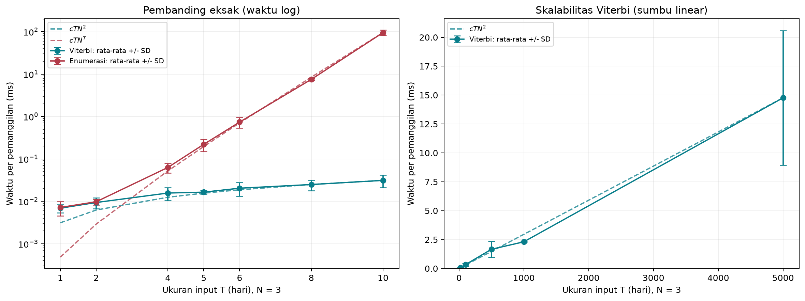
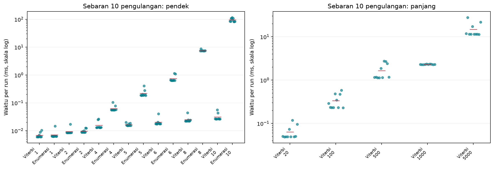
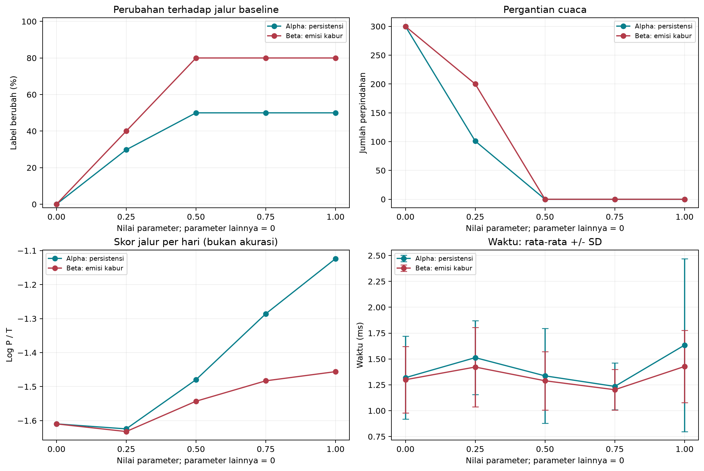

# Hasil Eksperimen Viterbi Cuaca

Hasil dihasilkan dari eksekusi notebook, bukan angka waktu yang diperkirakan.

## Metode
- Python 3.14.2; Linux-6.8.0-1064-azure-x86_64-with-glibc2.39; x86_64.
- Seed urutan benchmark: 20261011; algoritma dan data deterministik.
- Input: pola 10 aktivitas sintetis diulang; N=3 dan M=3 tetap. JSON asli tidak diubah.
- Ukuran pembanding (7): 1, 2, 4, 5, 6, 8, 10 hari; ukuran panjang (5): 20, 100, 500, 1000, 5000 hari.
- Viterbi log-space dibandingkan dengan enumerasi lengkap log-space (maksimal 10 hari).
- Per konfigurasi: 2 warm-up, kalibrasi batch target 10 ms (maksimal 1000 panggilan), lalu 10 run.
- Satu sampel adalah waktu batch / jumlah panggilan; SD sampel menggunakan pembagi R-1.
- Timer perf_counter_ns mencakup konversi log, decoding, dan backtracking; tidak mencakup input, I/O, validasi, atau visualisasi.
- Urutan konfigurasi diacak per run. Semua waktu disertakan tanpa pembuangan outlier.
- Kurva teori c*T*N^2 dan c*T*N^T ditambatkan pada rata-rata ukuran terbesar masing-masing seri.
- Error bar +/- 1 SD, bukan confidence interval. Bagian di bawah nol tidak terlihat pada sumbu waktu nonnegatif.
- Dua parameter diuji satu per satu, T=500: A_alpha=(1-alpha)A+alpha*I; B_beta=(1-beta)B+beta*U.
- Nilai parameter: 0, 0.25, 0.5, 0.75, 1; parameter lainnya=0; peluang awal tetap.

## Waktu Eksekusi

| Kelompok | Algoritma | T | Run | Panggilan/batch | Rata-rata ms | SD ms | Min ms | Maks ms |
|---|---|---:|---:|---:|---:|---:|---:|---:|
| pendek | Viterbi | 1 | 10 | 1000 | 0.006895 | 0.001526 | 0.005999 | 0.010357 |
| pendek | Enumerasi | 1 | 10 | 1000 | 0.007176 | 0.002642 | 0.006252 | 0.014691 |
| pendek | Viterbi | 2 | 10 | 917 | 0.009379 | 0.002677 | 0.008410 | 0.016996 |
| pendek | Enumerasi | 2 | 10 | 961 | 0.009767 | 0.001510 | 0.008717 | 0.012667 |
| pendek | Viterbi | 4 | 10 | 668 | 0.015685 | 0.005345 | 0.013006 | 0.026441 |
| pendek | Enumerasi | 4 | 10 | 180 | 0.062905 | 0.015989 | 0.055375 | 0.104119 |
| pendek | Viterbi | 5 | 10 | 605 | 0.016458 | 0.001713 | 0.015208 | 0.019996 |
| pendek | Enumerasi | 5 | 10 | 53 | 0.220759 | 0.070703 | 0.185043 | 0.404485 |
| pendek | Viterbi | 6 | 10 | 504 | 0.020386 | 0.007175 | 0.017439 | 0.040635 |
| pendek | Enumerasi | 6 | 10 | 15 | 0.739129 | 0.203726 | 0.633116 | 1.154559 |
| pendek | Viterbi | 8 | 10 | 422 | 0.024899 | 0.006951 | 0.022086 | 0.044527 |
| pendek | Enumerasi | 8 | 10 | 1 | 7.518479 | 0.409022 | 7.315573 | 8.675119 |
| pendek | Viterbi | 10 | 10 | 350 | 0.031198 | 0.010199 | 0.026406 | 0.056166 |
| pendek | Enumerasi | 10 | 10 | 1 | 95.173818 | 13.830872 | 81.668598 | 116.580824 |
| panjang | Viterbi | 20 | 10 | 192 | 0.063553 | 0.024878 | 0.048864 | 0.118658 |
| panjang | Viterbi | 100 | 10 | 43 | 0.333913 | 0.131404 | 0.231304 | 0.580854 |
| panjang | Viterbi | 500 | 10 | 8 | 1.660637 | 0.695519 | 1.131530 | 2.736215 |
| panjang | Viterbi | 1000 | 10 | 2 | 2.307923 | 0.024100 | 2.279120 | 2.348925 |
| panjang | Viterbi | 5000 | 10 | 1 | 14.765063 | 5.816268 | 11.393188 | 27.908167 |

## Sensitivitas

| Parameter | Alpha | Beta | Rata-rata ms | SD ms | Label berubah % | Perpindahan | Log P / hari | SD log P |
|---|---:|---:|---:|---:|---:|---:|---:|---:|
| alpha | 0.0 | 0.0 | 1.319340 | 0.399867 | 0.00 | 300 | -1.609605 | 0.0 |
| alpha | 0.25 | 0.0 | 1.512875 | 0.358225 | 29.80 | 101 | -1.624308 | 0.0 |
| alpha | 0.5 | 0.0 | 1.336833 | 0.458476 | 50.00 | 0 | -1.479652 | 0.0 |
| alpha | 0.75 | 0.0 | 1.234762 | 0.226002 | 50.00 | 0 | -1.285884 | 0.0 |
| alpha | 1.0 | 0.0 | 1.634010 | 0.835590 | 50.00 | 0 | -1.123690 | 0.0 |
| beta | 0.0 | 0.0 | 1.299399 | 0.322211 | 0.00 | 300 | -1.609605 | 0.0 |
| beta | 0.0 | 0.25 | 1.421961 | 0.383178 | 40.00 | 200 | -1.632139 | 0.0 |
| beta | 0.0 | 0.5 | 1.289326 | 0.282057 | 80.00 | 0 | -1.542976 | 0.0 |
| beta | 0.0 | 0.75 | 1.202782 | 0.195562 | 80.00 | 0 | -1.482932 | 0.0 |
| beta | 0.0 | 1.0 | 1.427417 | 0.348329 | 80.00 | 0 | -1.455960 | 0.0 |

## Interpretasi dan Validasi

- Pada T=10, rasio rata-rata waktu enumerasi / Viterbi = 3050.64. Rasio ini hanya berlaku untuk implementasi dan pengukuran lokal ini.
- Skor Viterbi cocok dengan enumerasi pada 7 ukuran pendek dan 10 konfigurasi sensitivitas (prefix 5 hari). Jalur 1/5/10 hari cocok dengan versi perkalian; skor jalur sensitivitas dihitung ulang secara independen.
- Semua 290 sampel benchmark dan sensitivitas menghasilkan keluaran yang tetap; SD log-probabilitas antar-run = 0. Tidak ada sebaran hasil stokastik karena kedua algoritma deterministik. Sebaran waktu tetap dilaporkan.
- Pada alpha=1: 50.00% label berubah dari baseline; 0 perpindahan cuaca. Ini sensitivitas jalur, bukan penurunan/peningkatan akurasi.
- Pada beta=1: 80.00% label berubah dari baseline; 0 perpindahan cuaca. Ini sensitivitas jalur, bukan penurunan/peningkatan akurasi.
- Variasi waktu besar: alpha, Viterbi, T=500, alpha=1.0, beta=0.0: rata-rata 1.634010 ms, SD 0.835590 ms, rentang 1.135244-3.727140 ms. Tidak ada sampel yang dihapus. Penyebab gangguan belum diisolasi; rata-rata pada titik acuan dapat menggeser kurva teori.
- Grafik tidak membuktikan kompleksitas asimtotik. Overhead konversi log lebih terasa pada T kecil; variasi wall-clock dapat mengganggu bentuk kurva. Bukti O(TN^2) berasal dari struktur perulangan Viterbi.
- Percobaan dibatasi satu pola sintetis dan satu lingkungan/proses. N tidak divariasikan; interaksi alpha-beta tidak diuji. Label sebenarnya tidak tersedia, sehingga tidak dilaporkan akurasi cuaca.
- Skor log P antar-model bukan ukuran mutu prediksi dan tidak dibandingkan sebagai akurasi.

## Artefak Reproduksi

- waktu_per_run.csv, ringkasan_waktu.csv, kurva_teoritis.csv
- sensitivitas_per_run.csv, ringkasan_sensitivitas.csv, jalur_sensitivitas.csv
- lingkungan.json: interpreter, OS, CPU, seed, konfigurasi, dan hash dataset.
- Jalankan semua sel notebook untuk mengulangi pengukuran. Waktu berubah antar-eksekusi; berkas hasil diperbarui.
- Laporan PDF IEEE sebelumnya belum diperbarui dengan eksperimen tambahan ini.
